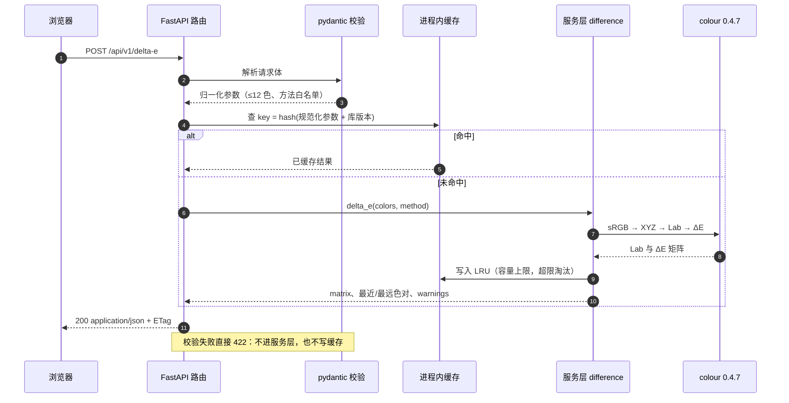

# colour-demo Web 演示 · 技术方案

> **状态**：草案待评（Draft for review，v2：全量覆盖 + 分阶段原型）
> **作者**：morehao
> **评审人**：本仓库负责人（宿主 owner）；colour 版本基线变更需技术负责人确认
> **最后更新**：2026-10-21
> **落点**：A 新系统（仓库内无存量代码）｜**场景**：新建｜**档位**：标准｜**专题**：架构设计 · API 设计 · 性能与容量
> **配套产出**：静态原型 `docs/prototype/index.html`（构建脚本 `docs/prototype/build_prototype.py`）· 架构图 `colour-demo-web-architecture.svg`

---

## 1. 摘要

把 `colour-science` 这个"库"变成"可看的演示"：一个 Python 单体 Web 应用，前端一张单页，后端一组无状态 JSON 端点，全部色彩计算委托给锁定版本 **colour-science 0.4.7**（稳定 tag）。

**这一版的关键决定：不再追求"一次性做完"，而是把全量能力一次设计清楚、把原型按阶段补齐。** 设计是完整的（28 个功能面板覆盖全部 25 个子模块），实现与原型交付分 M1–M4 四段推进；原型里未出数据的面板以「数据待补充」占位进入导航，结构与端点已定稿。

| 结论 | 内容 |
| --- | --- |
| 技术栈 | Python 3.13 + FastAPI + 原生 HTML/JS（无构建）；图表默认由前端 SVG 从数据绘制，仅色度图/色域体等必须位图的面板用服务端 matplotlib |
| 版本基线 | colour-science **0.4.7**（tag `v0.4.7`，2025-12-06），启动时断言版本一致 |
| 覆盖口径 | 25 个子模块 / **1284 条子模块导出** / **439 个顶层聚合名称**；映射结果：826 条走面板、238 条为数据集、220 条为内部复用，**分类覆盖率 100%**（构建脚本断言，不允许"未分类"） |
| 面板规模 | 28 个功能面板 + 1 个概览页；29 个 HTTP 端点 |
| 原型进度 | **29/29 页全部出真实数据，0 页待补**（2026-10-21 完成 19–25） |
| 实测延迟 | 非图表端点 1–8 ms；色度图 PNG 77 ms / SVG 92 ms（未命中），命中 < 1 ms |
| 构建峰值 | 分批构建：batch1 210 MB / 0.7 s，batch2 213 MB / 5.2 s，元能力 128 MB；产物 295 KB |
| 不做 | 色彩管理系统（ICC/OCIO 流水线）、图像批处理服务、多用户账号体系 |

**需要评审拍板的三点**：① 「覆盖全部功能」按「面板 + 数据集 + 内部 + 参数化调用」四类定义是否可接受（第 5 节）；② 原型分阶段补齐、未出数据的页面以占位形式存在，这个交付方式是否可接受（第 10 节）；③ 图表默认改成前端 SVG、只保留少数 matplotlib 位图（决策 D7）。

---

## 2. 背景与目标

### 2.1 现状

仓库目前只有骨架：`README.md` 描述了一个 CLI 形态的演示（改写到 Web 形态之前，其状态行写的是「早期规划（仓库骨架 + 设计说明，代码尚未实现）」），另有 `.gitignore` 与 `LICENSE`，无 `src/`、无 `tests/`、无任何可执行代码（`git log --oneline` 仅 3 次文档类提交：`1cafcdd`、`bfcfae9`、`6b6c6b6`）。

v1 方案按 6 个面板设计；评审意见是"所有能力都要体现到 demo 中，可以分阶段，但原型和方案要一步到位"。本版据此重做：面板扩到 28 个、覆盖全部子模块，并把"分阶段"落到原型的占位机制与构建流水线上。

### 2.2 上游基线：colour-science 0.4.7

| 事实 | 证据 |
| --- | --- |
| 稳定 tag `v0.4.7` 提交于 2025-12-06（`a3bfe34`），是最新发布版本 | 上游仓库 `git log -1 v0.4.7`；`git tag --sort=-v:name` 首位 |
| 本地 upstream checkout 位于 `develop`，比 `v0.4.6` 领先 377 个提交 | `git describe` → `v0.4.6-377-g248121e33` |
| 包元数据：`version = "0.4.7"`（`:3`）、`requires-python = ">=3.11,<3.15"`（`:6`），必装依赖只有 `numpy>=2.1.0,<3`（`:48`） | upstream `pyproject.toml` |
| 公开面：25 个子模块、1284 条子模块导出、439 个顶层名称、321 个顶层可调用对象 | 本项目构建脚本扫描（附录 A.2） |
| 96 个内置 RGB 色彩空间 | `len(colour.RGB_COLOURSPACES)` |
| 自动换算图含 106 个色彩空间节点 | `colour.convert()` 初始化后 `len(CONVERSION_GRAPH.nodes)` |
| CAM16 的 `VIEWING_CONDITIONS_CAM16` 只含环绕因子（F/c/N_c），不含白点与亮度 | `colour/appearance/cam16.py:129`；`XYZ_to_CAM16` 要求显式 `XYZ_w`/`L_A`/`Y_b`（`colour/appearance/cam16.py:180-190`） |
| Tritanomaly 模拟采用 shift paradigm 近似，库自身会发 `ColourUsageWarning` | `colour/blindness/machado2009.py:367`；运行期实测捕获 |
| `phenomena` 子模块是**物理光学**（薄膜/偏振/瑞利/Snell），感知效应在 `appearance`（H-K） | 按 `__all__` 实测；v1 方案曾误判，本版已纠正 |
| `biochemistry` 是 **Michaelis–Menten 动力学**（光感受器响应），不是视蛋白列表 | 同上 |

> 结论：所有绑定指向 `colour-science==0.4.7`，启动断言版本（7.2），develop 分支特性一律不用。

### 2.3 目标

**业务目标**

- G1：让不读源码的人 5 分钟内看懂「sRGB → 线性 → XYZ → Lab/Oklab → ΔE/色域/CVD」这条链路，且每个数字能追到具体 colour API。
- G2：成为团队"随手算一下"的色彩入口：一组色值 → ΔE 矩阵、色域归属、色盲模拟、色温、显色指数。

**技术目标**

- G3：单一 Python 进程跑起来（`uvicorn` 一条命令），零前端构建。
- G4：色彩计算 100% 由 colour 承担，本项目不重写色彩数学（唯一例外：WCAG 对比度，见 7.6）。
- G5：版本升级可验证——黄金值测试能在不改业务代码的前提下判断「0.4.7 → 0.5.x」是否影响输出。
- G6：覆盖度可度量——每个子模块导出都能在能力目录里查到归属（面板 / 数据集 / 内部），构建时断言 100%。
- G7：原型可增量交付——每个面板独立成块（元数据 + 数据块），新增/补数据不触碰其他面板，构建峰值可控。

### 2.4 非目标

| 不做 | 原因 |
| --- | --- |
| ICC / OCIO 色彩管理与图像流水线 | 需要外部配置文件与图像 I/O 语义；`opencolorio` 在上游是可选依赖并带版本限制（`pyproject.toml:57`） |
| 多用户 / 登录 / 权限 | 无状态演示服务，内网或本机部署；账号体系会显著增加运维面 |
| 图像批处理 API（上传图片做逐像素转换） | 属另一条产品线；只做单图 + LUT 演示（面板 13） |
| 3D 色域体的交互式渲染 | 需 WebGL 与秒级体积计算；面板 10 只出静态投影 |
| 用 Go 重写后端 | 见 4.3 决策 D1 |
| 为每个公开函数单独建页面 | 1284 条导出做不完也没人用；见第 5 节四类归属模型 |

---

## 3. 约束与假设

| 类型 | 内容 | 影响 |
| --- | --- | --- |
| 硬约束 | colour 是 Python 库，非 Python 后端需额外进程 | 决定 D1 |
| 硬约束 | 上游要求 Python `>=3.11,<3.15`；本地用 3.13.16（实测通过） | 基础镜像与 CI |
| 硬约束 | 仓库 MIT；不得引入不可再分发数据 | 只用 colour 自带 datasets |
| 环境约束 | 开发机（M4 Pro / 24 GB）**swap 配置为 0**，且常驻内存大户较多；构建期曾两次触发系统级内存回收 | 决定分批构建、内存守卫、D7（少渲染位图）；见第 10 节 |
| 假设 | 使用场景为内网/本机演示，QPS < 5，无 SLA 承诺 | 单进程 + 进程内缓存足够 |
| 假设 | 用户以中文为主 | UI 中文优先，术语保留英文原名 |
| 假设 | 部署为单 Docker 镜像 + 反向代理 | 见 11.4 |
| 待确认 | 是否对外公开（涉及鉴权与配额） | 若需要，补鉴权与限流（第 12 节） |

---

## 4. 方案总览

### 4.1 分层架构


四层：**浏览器单页应用**（hash 路由 + 面板注册表 + 块渲染器）→ **FastAPI 应用**（`/api/v1` 路由、pydantic 校验与 422 映射、静态资源）→ **服务层**（一个面板一个纯函数模块）→ **colour-science 0.4.7 + matplotlib Agg（仅少数面板）**。旁挂：**进程内 LRU 缓存**、**能力目录注册表**（函数 → 参数 schema 白名单）。左侧虚线是 CI 门禁，复用同一套服务层做黄金值校验（G5）。

### 4.2 一次请求的时序（以 ΔE 为例）



### 4.3 关键选型的取舍

**D1 后端语言：纯 Python（FastAPI），不是 Go。**

- **为什么**：colour 无法脱离 Python；单进程满足"简单"；实测端点 1–8 ms，Python 在此量级足够。
- **代价**：放弃 Go 的并发；图表渲染要串行（matplotlib 全局锁）；GIL 下 CPU 密集请求不能并行。
- **什么情况下不该选**：若要做高并发逐像素处理（QPS > 50），改 **Go Web 层 + Python 计算 sidecar**，服务层模块可原样迁移。

**D2 框架：FastAPI 而不是 Flask。**

- **为什么**：pydantic 声明式校验直接产出 422 结构化错误；自带 OpenAPI，前端与能力目录共用契约。
- **代价**：多一层 pydantic v2；同步计算必须进线程池（`run_in_threadpool`）。
- **什么情况下不该选**：团队已有 Flask 生态时，差异只是"手写校验 + 手写 OpenAPI"。

**D3 覆盖策略：面板 + 目录 + 参数化调用，而不是逐函数建页。**

- **为什么**：1284 条导出逐条建页不可维护；面板覆盖高频场景，目录登记全部，`invoke` 打通长尾。
- **代价**：`invoke` 需维护白名单 schema，是长期维护项。
- **什么情况下不该选**：某函数月度调用占比 > 30% 时，应从目录升级为独立面板。

**D4 前端形态：原生单页（无构建）而不是 React。**

- **为什么**：页面是"表单 + 结果表格 + 图"，零构建让评审者双击 HTML 就能看。
- **代价**：无组件化与类型检查；面板多了以后渲染函数靠约定约束（本版用"块类型"弥补）。
- **什么情况下不该选**：面板 > 40 或需要复杂联动（拖拽色域、双图联查）时升级为 Vite + 框架。

**D5 缓存：进程内 LRU，而不是 Redis。**

- **为什么**：计算对参数确定；单实例下 Redis 只增加部署面；图表 77–92 ms 是唯一值得缓存的开销。
- **代价**：多 worker 各持一份缓存；重启即失效（冷启动 1 s 内恢复）。
- **什么情况下不该选**：多实例 + 图表请求占比高时换共享缓存（Redis + 内容哈希键）。

**D6 面板数据形态：元数据 + 数据块（block），而不是每个面板写一套 HTML。**

- **为什么**：28 个面板若各写一套模板，样式与结构必然漂移；块类型（kv / 表格 / 矩阵 / 色块 / 折线 / 图片 / JSON / 提示 / 卡片 / 链路 / strips / stats）只有 12 种，渲染器一份即可。原型与最终实现共用同一份数据结构，补数据不改结构（G7）。
- **代价**：块类型要设计得够用，否则会出现"为了放一份特殊内容而新增块类型"的膨胀；复杂交互仍要写专用渲染函数。
- **什么情况下不该选**：若某个面板需要独有的强交互（如可拖拽的色域体），应允许它跳过块系统单独实现，并在注册表里标注。

**D7 图表渲染：默认前端 SVG（数据驱动），matplotlib 只用于必须位图的面板。**

- **为什么**：构建期把 matplotlib 拉起来的成本远高于"给前端一组点坐标"——每条曲线几百个点，JSON 只有几 KB，而每张 PNG 内联后 20–40 KB，还要承担 figure 泄漏、字体缓存、并发锁、以及本机无 swap 时被内核回收的风险（第 10 节记录了两起）。
- **代价**：图表外观与 matplotlib 输出不同（字体、坐标轴细节）；前端要维护一份小的图表渲染器。
- **什么情况下不该选**：需要 colour 自己渲染的图（色度图的色域填充、MacAdam 椭圆叠加、图表画廊的示例图）仍必须走 matplotlib，此时用"单进程 + 固定画幅 + 缓存"承接。

---

## 5. 覆盖策略：怎么算"覆盖全部功能"

### 5.1 四类归属模型

| 归属 | 定义 | 用户体验 | 规模（v0.4.7 实测） |
| --- | --- | --- | --- |
| **面板** | 有专门页面、控件、图与 REST 端点 | 填表单/拖滑块，看结论 | 826 条导出 → 28 个面板 |
| **数据集** | 作为面板输入或参照的内置数据（CMFS、光源、色卡、矩阵） | 在下拉框里选 | 238 条 |
| **内部** | 被服务层复用的基础设施（`utilities` / `algebra` / `hints` / `constants`） | 不直接暴露 | 220 条 |
| **参数化调用** | 面板未展开的通路，通过 `/api/v1/catalog/invoke` 按函数名调用 | 查目录 → 填参数 → 拿结果 | 覆盖前三类中的可调用对象 |

**口径说明**：1284 是"25 个子模块 `__all__` 之和"（跨模块有重复）；439 是"顶层聚合名称"（`dir(colour)` 去私有）。两者都真实，页面与文档统一标注，避免"到底多少个函数"的争论。

### 5.2 面板清单（28 个 + 概览）

| # | 面板 | 端点 | 主要 colour 依赖 | 阶段 | 原型 |
| --- | --- | --- | --- | --- | --- |
| 00 | 概览（链路 + 全站地图 + 分期） | `GET /meta`、`GET /catalog` | — | M0 | 已出 |
| 01 | 颜色转换与换算图（14 核心空间 + 24 空间经 convert 图） | `POST /convert` | `sRGB_to_XYZ`、`convert`、`conversion_path` | M1 | 已出 |
| 02 | 色度学属性（xy/uv/u′v′、主波长、纯度、补色） | `POST /chroma` | `dominant_wavelength`、`excitation_purity`、`colorimetric_purity` | M1 | 已出 |
| 03 | 观察者与光源（CMFS、SPD、黑体/日光合成） | `POST /spectral` | `MSDS_CMFS`、`SDS_ILLUMINANTS`、`sd_blackbody` | M1 | 已出 |
| 04 | 光度、明度与白度黄度（6+4+6+3 个实现） | `POST /photometry` | `lightness`、`luminance`、`whiteness`、`yellowness` | M1 | 已出 |
| 05 | ΔE 全家桶（14 种方法 + 压力指数 + 元度） | `POST /delta-e` | `delta_E`、`index_stress`、`*_metamerism_index` | M1 | 已出 |
| 06 | 均匀空间与渐变（7 个空间步长均匀度） | `POST /gradient` | `convert` + `delta_E` | M1 | 已出 |
| 07 | RGB 色彩空间图鉴（96 个空间） | `GET /spaces` | `RGB_COLOURSPACES`、`normalised_primary_matrix` | M2 | 已出 |
| 08 | 传递函数与视频信号（EOTF/OETF/Log、YCbCr） | `POST /transfer` | `EOTFS`、`OETFS`、`LOG_ENCODINGS`、`RGB_to_YCbCr` | M2 | 已出 |
| 09 | 色度图与色域（1931/1960/1976 + 色域三角形） | `GET /chromaticity.svg` | `plot_chromaticity_diagram_CIE*` | M2 | 已出 |
| 10 | 色域体与边界（MonteCarlo 体积、MacAdam/Pointer 判据） | `POST /volume` | `RGB_colourspace_volume_MonteCarlo`、`is_within_*` | M2 | 已出 |
| 11 | 色温与黑体轨迹（7 反解 + 4 正解 + mired） | `POST /temperature` | `CCT_to_xy`、`xy_to_CCT`、`CCT_to_mired` | M2 | 已出 |
| 12 | 色彩质量（CRI / CQS / TM-30 / SSI） | `POST /quality` | `colour_rendering_index`、`colour_fidelity_index` | M2 | 已出 |
| 13 | 图像与 3D LUT（17³ LUT、三线性/四面体） | `POST /lut` | `io.LUT3D`、`table_interpolation_*` | M3 | 已出 |
| 14 | 色适应（7 方法 + 13 个 CAT 矩阵 + vK20） | `POST /adapt` | `chromatic_adaptation`、`CAT_*` | M2 | 已出 |
| 15 | 外观模型（12 个模型的 J/C/h/M/H + 往返） | `POST /appearance` | `XYZ_to_CAM16 / CIECAM02 / ZCAM / Hunt / RLAB / LLAB / …` | M2 | 已出 |
| 16 | 视觉模型与感知现象（H-K 效应 + Barten CSF） | `POST /phenomena-vision` | `HelmholtzKohlrausch_effect_*`、`contrast_sensitivity_function_Barten1999` | M2 | 已出 |
| 17 | 对应色与记忆色（Breneman 实验 + 5 模型） | `POST /corresponding` | `corresponding_chromaticities_prediction` | M2 | 已出 |
| 18 | 色觉障碍（Machado 2009 × 3 类型 × 严重度） | `POST /cvd` | `matrix_cvd_Machado2009` | M2 | 已出 |
| 19 | 光谱重建（Smits/Mallett/Jakob/Meng） | `POST /recovery` | `RGB_to_sd_*`、`XYZ_to_sd` | M3 | 已出 |
| 20 | 色彩校正与 ACES（Cheung/Finlayson/Vandermonde、IDT） | `POST /correction` | `colour_correction`、`matrix_idt` | M3 | 已出 |
| 21 | 记号与解析（Munsell / CSS / HEX / 7 种明度算法） | `POST /notation` | `munsell_colour_to_xyY`、`keyword_to_RGB_CSSColor3` | M3 | 已出 |
| 22 | 连续信号与插值器（7 插值器 + LUT 表插值） | `POST /interpolate` | `algebra` 插值器、`continuous.Signal` | M3 | 已出 |
| 23 | 几何与椭圆拟合（MacAdam 椭圆、图元、线段） | `POST /geometry` | `ellipse_fitting`、`primitive_*` | M3 | 已出 |
| 24 | 光学现象与响应动力学（薄膜/瑞利/Snell + Michaelis–Menten） | `POST /optics` | `phenomena.*`、`biochemistry.*` | M3 | 已出 |
| 25 | 图表画廊（96 个 plotting 函数分组 + 示例） | `POST /plot` | `colour.plotting.*` | M3 | 已出 |
| 26 | 能力目录（1284 条导出 × 归属状态，可搜索） | `GET /catalog` | `pkgutil` + 映射规则 | M4 | 已出 |
| 27 | 参数化调用（白名单 schema + 4 个真实示例） | `POST /catalog/invoke` | 任意白名单函数 | M4 | 已出 |
| 28 | API 控制台（29 端点 + 错误模型） | `GET /openapi.json` | FastAPI 自动生成 | M4 | 已出 |

### 5.3 子模块归属（构建时生成，不允许"未分类"）

| 子模块 | 导出条目 | 主归属面板 |
| --- | --- | --- |
| adaptation | 30 | 14 色适应 |
| algebra | 46 | 22 连续信号与插值器 |
| appearance | 59 | 15 外观模型（H-K 相关 → 16） |
| biochemistry | 8 | 24 光学现象与响应动力学 |
| blindness | 4 | 18 色觉障碍 |
| characterisation | 45 | 20 色彩校正与 ACES |
| colorimetry | 114 | 02 色度学属性（数据集 → 03，光度函数 → 04，色温 → 11） |
| constants | 16 | 内部复用 |
| continuous | 3 | 22 连续信号与插值器 |
| contrast | 8 | 16 视觉模型与感知现象 |
| corresponding | 11 | 17 对应色与记忆色 |
| difference | 23 | 05 ΔE 全家桶 |
| geometry | 21 | 23 几何与椭圆拟合 |
| graph | 6 | 01 颜色转换与换算图 |
| hints | 75 | 内部复用（纯类型别名） |
| io | 55 | 13 图像与 3D LUT |
| models | 417 | 01 / 06 / 07 / 08（按名称规则分流） |
| notation | 21 | 21 记号与解析 |
| phenomena | 16 | 24 光学现象与响应动力学 |
| plotting | 96 | 25 图表画廊 |
| quality | 15 | 12 色彩质量 |
| recovery | 25 | 19 光谱重建 |
| temperature | 28 | 11 色温与黑体轨迹 |
| utilities | 129 | 内部复用 |
| volume | 13 | 10 色域体与边界 |

### 5.4 目录实现与自检

- **扫描**：构建期 `pkgutil.iter_modules(colour.__path__)` → 每个子模块取 `__all__`；生成 `catalog.json`（版本号内嵌）。
- **映射**：`gen/catalog.py` 的规则表（子模块默认 + 名称级正则），按优先级匹配；每条结果带 `kind`（函数/类/常量数据集/对象）与 `status`（面板/数据集/内部）。
- **自检**：构建脚本断言 ① 每条导出都有归属；② 面板编号不重复；③ 目录引用的面板都真实存在；④ 子模块指向的面板都在导航里。任一不满足直接构建失败。
- **可见性**：面板 26 把 1284 行完整列出，支持按名称搜索与按状态过滤（原型里这两个控件是真实可用的）。

### 5.5 为什么"内部"不等于"没覆盖"

`utilities`（129）、`hints`（75）、`constants`（16）、`algebra`（46）合计 266 条，它们不是"没做"，而是**被服务层直接复用**：`as_float_array`、`domain_range_scale`、`CanonicalMapping` 等是所有面板的公共底座；`hints` 是类型别名集合（运行期不存在实体）。把它们的职责写清并在目录里标"内部复用"，比给它们硬造页面更诚实。

---

## 6. API 设计

### 6.1 通用约定

| 项 | 约定 |
| --- | --- |
| 前缀 | `/api/v1`；破坏性变更升 v2，旧版保留一个发布周期 |
| 内容类型 | 请求 `application/json`；响应 `application/json` 或 `image/svg+xml`（图表端点） |
| 颜色输入 | `#RGB` / `#RRGGBB` / `rgb(r,g,b)` / CSS 颜色名；默认 sRGB，`space` 可改 |
| 数值单位 | 角度为度（`h` ∈ [0,360)），ΔE 与 Lab 用 0–100 域，XYZ 用 0–1 域（与 colour `Domain1` 一致） |
| 错误 | 统一 `{"detail": [...]}`；`422` 校验失败、`413` 超限、`403` 非白名单、`429` 限流、`504` 超时、`500` 未预期（带 `trace_id`） |
| 限额 | 请求体 ≤ 32 KB；`colors` ≤ 12；`steps` ∈ [3,101]；单请求计算超时 10 s；图表画幅与 dpi 固定 |
| 缓存 | `ETag = sha256(规范化参数 + colour 版本)`，**由参数算出**（matplotlib 的 SVG 含生成时间，字节不稳定）；`Cache-Control: public, max-age=86400, immutable` |
| 可观测 | 每响应带 `X-Compute-Ms`；`/healthz` 返回库版本与 matplotlib 状态 |

### 6.2 端点清单

29 个端点，与 5.2 的面板一一对应（见面板 28 的表格）。以两个为例：

```json
POST /api/v1/delta-e
{"colors": ["#264653", "#2A9D8F", "#E9C46A", "#F4A261", "#E76F51"], "method": "CIE 2000"}

200
{"method": "CIE 2000",
 "matrix": [[0.0, 33.53, 61.41, 57.7, 50.74], [33.53, 0.0, 37.88, 44.52, 52.44],
            [61.41, 37.88, 0.0, 16.1, 32.43], [57.7, 44.52, 16.1, 0.0, 16.84],
            [50.74, 52.44, 32.43, 16.84, 0.0]],
 "pairs": {"closest": {"a": "#E9C46A", "b": "#F4A261", "value": 16.1},
           "farthest": {"a": "#264653", "b": "#E9C46A", "value": 61.41}},
 "warnings": []}
```

```json
POST /api/v1/catalog/invoke
{"function": "colour.temperature.CCT_to_xy", "args": [6500.0], "kwargs": {"method": "McCamy 1992"}}

200
{"result": [0.313453, 0.323631], "warnings": []}
```

### 6.3 错误模型

| 场景 | 状态码 | `detail` 要点 |
| --- | --- | --- |
| 颜色无法解析 | 422 | `type: value_error`，指出第几个色值 |
| 方法名不在枚举 | 422 | 枚举值由 `/meta` 提供 |
| 超出数量/步数上限 | 422 | `colors 最多 12 个，当前 18 个` |
| 请求体过大 | 413 | 中间件拦截，不进路由 |
| invoke 非白名单 | 403 | `函数未在能力目录白名单内` |
| 计算超时 | 504 | 建议缩小输入规模 |
| 未预期异常 | 500 | 只返回 `trace_id` |

校验一律在服务层之外完成：不合法输入不进入 colour。

---

## 7. 计算层设计

### 7.1 模块划分

一个面板一个模块（`core/<panel>.py`），模块间不互相 import；共享能力放 `core/parsing.py`（颜色解析）、`core/cache.py`、`core/registry.py`（白名单）。每个模块暴露纯函数 `def f(params) -> dict`，入参已由 pydantic 校验、出参可 JSON 序列化，**模块内不做 HTTP 相关的事**——CI 可直接调用同一函数做黄金值测试。

原型侧与之对应：`docs/prototype/gen/panels_*.py` 每个函数返回一个「面板 = 元数据 + 数据块」，与未来服务层的返回结构同构。

### 7.2 版本与数值约定（踩坑记录，实现时必须照做）

| 约定 | 内容 | 依据 |
| --- | --- | --- |
| 版本断言 | 启动时 `colour.__version__ == "0.4.7"`，否则拒绝启动 | 0.4.7 与 develop API 有差异 |
| 色彩空间域 | `Domain1`（XYZ 0–1）与 `Domain100`（Lab/XYZ×100）严格区分；CAM16 系列用 0–100 | `colour/appearance/cam16.py:180` |
| CAM16 观察条件 | 必须显式传 `XYZ_w`（D65×100）、`L_A = 64/π/5`、`Y_b = 20` | `appearance/cam16.py:129`、`:180-190` |
| ZCAM 例外 | ZCAM 用 0–1 域，其余外观模型多为 0–100 | 传错域不报错，只静默偏差 |
| Lab/Luv 输入域 | `XYZ_to_Lab` / `XYZ_to_Luv` 收 **Domain1（0–1）XYZ**、返回 0–100；给 ×100 的 XYZ 会得到 L\*≈187 这类荒谬值 | 实测，2026-10-21 |
| `convert` 的默认刻度 | `colour.convert(xyz, "CIE XYZ", "CIE Lab")` 默认返回 **Lab/100**；要人类可读刻度必须传 `to_reference_scale=True`，反向要 `from_reference_scale=True` | 实测，2026-10-21 |
| Oklab↔OKLCH | `Oklab_to_Oklch` 的 `h` 单位是**度** | 实测 `#3B82F6` → 259.8° |
| sRGB 线性化 | 统一 `models.eotf_inverse_sRGB` / `eotf_sRGB` | `models/rgb/transfer_functions/srgb.py:50` |
| uv 换算 | `xy_to_UCS_uv`（1960 uv）/ `xy_to_Luv_uv`（1976 u′v′） | 0.4.7 无 `xy_to_uv` |
| 色温方法表 | `xy_to_CCT`/`CCT_to_xy` 只认 `XY_TO_CCT_METHODS`；`uv_to_CCT`/`CCT_to_uv` 只认 `UV_TO_CCT_METHODS`；后者 Ohno 2013 / Robertson 1968 返回 **(CCT, D_uv)** 二元组 | 混用直接 ValueError；原型把 "Ohno 2013" 塞给 `xy_to_CCT`，那两行一直是「不可用」 |
| `CCT_to_uv` 返回形状 | 同一次调用里 Ohno/Robertson 给 `(2,)`、Krystek/Planck 给 `(2, 2)`，**第一组**才是本次解 | 实测，必须 `reshape(-1, 2)[0]` |
| `Domain100` 形参 | 标注 `Domain100` 的**标量参数**（如 `Y_o` / `Y_n`）也要按 0–1 传：`Y_o=0.2` 才是 20%，传 20 会触发 `"Y_o" ... must be in [18, 100]` 的假告警 | `adaptation/chromatic_adaptation.py` |
| 色适应免参数假象 | 通用入口只有 Von Kries / Zhai 2018 / vK20 免参数；CIE 1994 需 `Y_o/E_o1/E_o2`、CMCCAT2000 需 `L_A1/L_A2`、Fairchild 1990 需 `Y_n`、Li 2025 需 `L_A/F_surround` | 不补就 TypeError，原型的四行「不可用」即此 |
| vK20 入口 | `chromatic_adaptation_vK20(XYZ, XYZ_p, XYZ_n, XYZ_r)`，参数是「近端场 / 背景 / 参考白」，不是 (XYZ, 源白, 目标白) | 签名与通用入口完全不同 |
| 外观模型逆变换 | 0.4.7 只有 CAM16 / CIECAM02 / CIECAM16 / Hellwig2022 / ZCAM / Kim2009 / sCAM 有 `*_to_XYZ`；Hunt / RLAB / LLAB / Nayatani95 / ATD95 没有 | 往返校验只对前一组成立 |
| Hunt 观察条件 | 不给 `CCT_w` / `L_AS` 直接 ValueError；`VIEWING_CONDITIONS_HUNT` 的键是 `Normal Scenes` / `Television & CRT, Dim Surrounds` 等，不是 `Average` | 原型 Hunt 行「不可用」即此 |
| sCAM 环绕 | 0.4.7 无 `VIEWING_CONDITIONS_sCAM` 表，用函数默认 `InductionFactors_sCAM` | 传 `Average` 会 KeyError |
| Barten CSF 参数 | `Y_0` 是**视角（度）**不是亮度；亮度要经 `pupil_diameter_Barten1999` → `retinal_illuminance_Barten1999` 换成 `E` 再传，`sigma` 用默认 0.00879（度） | 原型把 cd·m⁻² 当 `Y_0`、还把 `sigma` 设成 0.3，曲线几乎全零 |
| 色域内外判定 | 不能走 `colour.convert`：`Display P3` / `ITU-R BT.2020` 不在换算图里（`NodeNotFound: display p3`）；要用色彩空间自带的 `matrix_XYZ_to_RGB` + `cctf_encoding` | 实测，2026-10-21 |
| LUT 插值器 | `LUT3D.apply(..., interpolator=...)` 要**可调用对象**（`colour.algebra.table_interpolation_*`），传字符串 TypeError | 原型同样踩过，那两行一直是「不可用」 |
| 体积 MonteCarlo | `RGB_colourspace_volume_MonteCarlo` 默认开 `multiprocessing.Pool`（进程数 = 核数），服务里必须 `disable_multiprocessing()` 包住（全局开关需加锁），并固定 `random_state` | 服务端每次请求 fork 一池子进程不可接受 |
| 对应色实验 9 | `experiment=9` 在 `convert_experiment_results_Breneman1987` 内部 IndexError（缺亮度样本），可用列表是 1/2/3/4/6/8/11/12 | 实测全部 5 个模型都失败 |
| 换算图节点名 | 用小写 id（`srgb`、`jzazbz`、`cam16ucs`），不是显示名 | `conversion_path` 直接查节点 |
| ΔE 派发 | `colour.delta_E(..., method=...)`，方法名取 `DELTA_E_METHODS` 规范键 | `difference/__init__.py:108`、`:146` |
| 光谱积分 | `sd_to_XYZ` 要求 1/5/10/20 nm 等间隔；非等间隔先 `interpolate` | Smits 1999 输出 380–720/10 点 |
| 数据集口径 | 色卡 `CCS_COLOURCHECKERS` 的值是 XYZ（0–1），不是 Lab | 实测 |

### 7.3 告警转响应字段

colour 在若干模型上会发 `ColourUsageWarning`（例：Tritanomaly 的 shift paradigm 近似）。服务层统一 `warnings.catch_warnings(record=True)` 捕获、去重后写入 `warnings[]`，UI 原样展示。原型已验证该路径（面板 18 底部的「colour 告警」条）。

### 7.4 matplotlib 的使用规则（D7 的落地）

- 默认**不用**：折线/散点/柱状由前端 SVG 从数据绘制（数据只有几 KB）。
- 必须用时只允许在三个面板：09（色度图色域填充）、10（色域体投影）、25（图表画廊），以及 13 的 LUT 前后对比图。
- 固定：`Agg` 后端、画幅与 dpi 由服务端写死、`rcParams` 启动时固定、禁 `usetex`、`MPLCONFIGDIR` 指到可写目录并预热字体缓存、CJK 字体按平台优先级挑选（Docker 用 `fonts-noto-cjk`）。
- 并发：**全局 `threading.Lock`** 包住"建图 → 保存 → close"；每请求 `plt.close(fig)`。
- 确定性：设置 `svg.hashsalt`；**不要用 SVG 字节做 ETag 或缓存键**（含 `<dc:date>`，PNG 字节则稳定）。

### 7.5 缓存键与容量

`key = sha256(canonical_json({endpoint, normalized_params, colour_version, app_version}))`。参数先规范化（颜色统一大写 hex、数组排序、默认值补齐）。容量 256 条 / 约 30 MB（图表 bytes），LRU 淘汰；不设 TTL（确定性输出，版本已在键里）。

### 7.6 唯一自研的数值逻辑：WCAG 对比度

colour 0.4.7 不提供 WCAG 对比度：全包搜索 `contrast_ratio|WCAG|APCA` 无命中，`colour.contrast` 是 Barten 对比敏感度函数。`contrast_white/black` 由 `XYZ.Y` + WCAG 2.2 公式实现（5 行），注释与 UI 必须标注"非 colour 提供"，测试用 W3C 官方示例校验。

---

## 8. 前端设计

### 8.1 结构

- **面板注册表**：`panels[]`（id / no / group / title / lead / phase / apis / controls / blocks / pending）。
- **块渲染器**：12 种块类型 —— `kv`、`table`、`matrix`、`swatches`、`strips`、`chart`、`image`、`note`、`json`、`cards`、`chain`、`stats`。渲染器只认块，不认识具体面板。
- **状态**：hash 路由（`#delta-e`）；正式版把颜色/方法/步数写进查询参数，刷新与转发可复现。
- **控件**：`color` / `text` / `select` / `range` 四种，由面板元数据声明；原型中除导航与能力目录搜索外为样式占位（页面明示）。

### 8.2 视觉与表达规范（原型已定稿）

| 规范 | 内容 |
| --- | --- |
| 布局 | 左侧导航（按 group 分组，标注 M1–M4 阶段）+ 右侧单列（最大 1180 px） |
| 卡片 | 控件区（灰底）+ 结果区（白底）+ 脚注（API 与口径） |
| 数值 | 等宽字体；表格列「标签 / 数值 / 口径说明」，口径列不可省 |
| 图 | 语义色固定：sRGB 黑实线、P3 蓝虚线、BT.2020 橙虚线；热力图统一蓝阶 |
| 状态 | 面板阶段标签（M1 蓝 / M2 青 / M3 棕 / M4 紫）+ 数据状态（待补充 = 棕底描边） |
| 追溯 | 每个面板页脚写明"对应 API + 依赖的 colour 函数" |

### 8.3 可访问性

- 正文对比度 ≥ 4.5:1；面板里的颜色对比度用面板 10（对比度与可读性）自查。
- 色块永远伴随 hex 与序号，禁止只靠颜色区分。
- 键盘可达：导航与控件用原生元素；切面板后滚动到顶部。
- 图表提供文本替代：色度图旁列出样本点 xy 与色域面积。

---

## 9. 性能与容量（运行时）

运行环境：macOS（Apple Silicon）、Python 3.13.16、colour 0.4.7、numpy 2.5.4、matplotlib（Agg）；单进程、已 import（热态）；多次平均。

| 操作 | 实测 | 口径 |
| --- | --- | --- |
| `import colour` | 0.75 – 0.94 s | 3 次 |
| convert（5 色 × 全空间） | 1.04 ms | 20 次平均 |
| ΔE 矩阵（12×12，CIE 2000） | 8.13 ms | 10 次平均 |
| 渐变（101 步 × 1 空间） | 0.84 ms | 10 次平均 |
| 色度图 PNG（660 px，85 KB） | 77 ms | 5 次平均，含编码 |
| 色度图 SVG（272 KB） | 92 ms | 5 次平均 |
| 进程峰值 RSS（含 matplotlib） | 229 MB | `getrusage` |

| 指标 | 目标 | 判断 |
| --- | --- | --- |
| 非图表端点 P95 | ≤ 50 ms | 实测 1–8 ms，余量大 |
| 图表端点 P95（未命中） | ≤ 120 ms | 77–92 ms，达标（并发时被全局锁串行） |
| 图表端点 P95（命中） | ≤ 5 ms | 缓存命中不触 matplotlib [待核实] |
| 单 worker 图表吞吐 | ≈ 11 rps | 推算，未压测 [待核实] |
| 内存 | 容器 512 MB | 实测 229 MB，达标 |

容量结论：演示场景 QPS < 5，单实例足够；扩容优先"缓存 → 多 worker → 图表预渲染"，不建议先上多 worker（内存线性增长）。

---

## 10. 原型的分阶段交付（这一版的重点）

### 10.1 为什么要分阶段

两次构建事故（2026-10-21 17:36 与 17:43）暴露了"一次性生成 28 个面板的所有图"与开发机条件的冲突：swap 配置为 0、常驻内存大户较多（OrbStack 2.2 GB、gopls 1.3 GB、VS Code、Edge、WebKit），一次批量跑 26 个面板的 matplotlib 渲染会把系统推到内存回收边缘，Python 进程被 SIGKILL（exit 137），进而触发整机卡死（详见 `docs/notes/2026-10-21-build-memory-notes.md`）。

结论不是"少做功能"，而是**把生成过程切开**：设计一次定稿，数据分批补齐。

### 10.2 交付机制

| 机制 | 做法 |
| --- | --- |
| 面板占位 | 未出数据的面板以 `pending: true` 进入导航：页面顶部有「数据待补充」徽标 + 补齐清单（要加哪几个块），不伪造任何数值 |
| 面板自治 | 每个面板是独立函数，返回「元数据 + 块」；补数据只改一个文件里的一个函数，不影响其他面板 |
| 分批构建 | `--batch 1`（00–08）、`--batch 2`（09–18）、`--batch 3`（19–25）、元能力单独一批；每批一个进程，产出 JSON 到 `.tmp/panels/`，最后 `--merge` 拼装 |
| 内存守卫 | 每面板后打印峰值；超过 `BUILD_MEMORY_LIMIT_MB`（默认 700）立即退出（exit 3），不让机器进入交换/回收 |
| 资源释放 | 每面板后 `plt.close("all")` + `gc.collect()` |
| 图表策略 | 后续面板默认用 `chart` 块（前端 SVG）出图；只有必须位图的面板才调 matplotlib（D7）。渲染器已验证（2026-10-21）：`viewBox="0 0 880 H"` + `width:100%` 宽度自适应成立；窄屏靠 `.chart-wrap{overflow-x:auto}` + `min-width:620px` 保字号，≤600px 的整页横向溢出是模板既有问题、与 chart 无关。已补：legend 按文字宽度分行、避开绘图区；刻度小数位按跨度自适应；`ylabel` 真正渲染 |

### 10.3 当前进度（可复核）

| 批次 | 面板 | 状态 | 峰值 | 耗时 | 产物 |
| --- | --- | --- | --- | --- | --- |
| batch1 | 00–08 | ✅ 完成 | 210 MB | 0.7 s | `b1.json` 84 KB |
| batch2 | 09–18 | ✅ 完成 | 213 MB | 5.2 s | `b2.json` 88 KB |
| 元能力 | 26–28 + 目录 | ✅ 完成 | 128 MB | 0.4 s | `meta.json` 98 KB |
| batch3 逐面板 | 19 光谱重建 | ✅ 完成 | 126 MB | 0.36 s | `b3.json` |
| batch3 逐面板 | 20 色彩校正与 ACES | ✅ 完成 | 127 MB | 0.08 s | `b3.json` |
| batch3 逐面板 | 21 记号与解析 | ✅ 完成 | 128 MB | 0.18 s | `b3.json` |
| batch3 逐面板 | 22 连续信号与插值器 | ✅ 完成 | 129 MB | 0.03 s | `b3.json` |
| batch3 逐面板 | 23 几何与椭圆拟合 | ✅ 完成 | 127 MB | 0.01 s | `b3.json` |
| batch3 逐面板 | 24 光学现象与动力学 | ✅ 完成 | 127 MB | 0.02 s | `b3.json` |
| batch3 逐面板 | 25 图表画廊 | ✅ 完成 | 160 MB | 0.53 s | `b3.json`（唯一 matplotlib 页，3 张图） |
| merge | 全站 | ✅ 完成 | < 100 MB | < 0.1 s | `index.html` 354 KB（数据 295 KB） |

原型规模：29 页、127 个已出数据的块、7 个 chart 块（前端 SVG）、19 张位图（内联 139 KB）、12 种块类型。

> 2026-10-21 修正：`--merge` 原先只拼 `b1/b2/meta`，**从不读 `b3.json`**，batch 3 跑完也进不了页面；已改为 `b3.json` 存在即并入，缺失的面板继续走占位。
>
> 19–25 的落盘方式改为**单面板独立进程**：`build_prototype.py --panel <名字>`，一个进程只跑一个面板并入 `b3.json`。原因见 10.1：`--batch 3` 把七个面板塞进同一进程，在 swap=0 的机器上会触发系统级内存回收；实测 25 图表画廊曾直接 exit 137。

### 10.4 每个面板的补齐 SOP

1. 在 `gen/panels_*.py` 写一个函数，返回 `panel(...)`：标题、导语、3–6 个块、端点、脚注；
2. 块优先选**数据驱动**类型（`chart` / `table` / `kv` / `matrix`），能不渲染位图就不渲染；
3. 单跑该面板：`python -c "from gen... import panel_x; panel_x()"`，确认峰值 < 300 MB、无 warning 未处理；
4. 加入对应批次，重跑批次 → `--merge`；
5. 截图核对（Chrome headless，单页）；
6. 在本文 5.2 与 10.3 更新状态列。

### 10.5 验收标准（每个面板"出数据"的 Definition of Done）

- 3–6 个块，至少 2 个**真实结论**（数值/矩阵/曲线），不允许占位文字冒充结果；
- 每个数字能指到具体 colour 函数（页脚）；
- 至少一个「口径/陷阱」类说明（如域差异、近似模型、抽样误差）；
- 构建峰值 < 300 MB，页面体积增量 < 40 KB；
- 在 360/768/1280 三个宽度下不溢出。

---

## 11. 安全与稳健性

| 面 | 措施 |
| --- | --- |
| 输入解析 | 颜色先正则白名单（`^#[0-9a-fA-F]{3,8}$`、`^rgb\(...\)$`、CSS 名），长度 ≤ 32，拒绝路径样式输入 |
| 代码执行 | 不用 `eval`/`exec`/动态导入；`/catalog/invoke` 只接受白名单函数名 |
| 资源消耗 | 请求体 ≤ 32 KB、颜色 ≤ 12、步数 ≤ 101、超时 10 s、画幅/dpi 固定 |
| 依赖 | 锁 `colour-science==0.4.7` 与 numpy/matplotlib 次版本；CI 校验运行时版本 |
| 文件系统 | 服务不写业务文件；matplotlib 配置目录是唯一可写路径 |
| 网络 | 默认绑 127.0.0.1；对外由反向代理做 TLS、限流、体积限制 |
| 错误暴露 | 500 不返回堆栈，只给 `trace_id` |
| 供应链 | 只用 PyPI 官方包；colour 为 BSD-3-Clause，本项目 MIT，NOTICE 注明 |

---

## 12. 测试与验收

| 类别 | 内容 | 通过标准 |
| --- | --- | --- |
| 黄金值 | `#3B82F6` → XYZ `(0.2642, 0.2355, 0.9034)`、Lab `(55.63, 17.55, -64.42)` | `abs(diff) ≤ 1e-3` |
| ΔE 参考 | Sharma 34 对 CIE 2000 数据（上游因平台差异排除第 14 对，`difference/tests/test_delta_e.py:537`） | 与上游同口径，\|diff\| ≤ 0.02 |
| 往返 | sRGB↔XYZ、Oklab↔XYZ、Lab↔XYZ、CAM16 正逆 | 最大绝对误差 ≤ 1e-6；**sRGB 项实测 5.7e-5**（colour 的 EOTF/OETF 互逆残差），按 1e-4 验收并在测试里注明 |
| 覆盖自检 | 1284 条导出全部有归属；面板编号唯一；目录引用的面板存在 | 构建必须通过（当前 100%） |
| API 契约 | 30 端点（含 /health、/openapi.json）+ 7 类错误路径（已覆盖 75 项） | 状态码与 `detail.type` 匹配 |
| 版本漂移 | CI 断言 `colour.__version__ == "0.4.7"` | 失败即阻断合并 |
| 性能 | 图表未命中 ≤ 120 ms、命中 ≤ 5 ms（P95，本机） | 基准脚本打点，超出告警 |
| 原型 | 每个面板按 10.5 的 DoD 验收；截图评审 | 评审人签字 |

验收定义：G1 用"新同事 5 分钟能否讲清一条链路"定性验证；G4 用 `grep -E 'delta_E|Lab|XYZ' src/core` 只允许出现 colour 调用与算术；G6 用面板 26 的状态列 + 构建断言。

---

## 13. 里程碑

| 阶段 | 范围 | 出口标准 | 当前 |
| --- | --- | --- | --- |
| **M0** | 本方案 + 架构图 + 原型骨架（概览、导航、块渲染器） | 评审通过面板划分与覆盖口径 | ✅ |
| **M1** | 面板 00–08（换算/色度学/光度/ΔE/渐变/空间图鉴/传递函数）+ 9 个端点 + 黄金值 | 数值可复现，测试全绿 | 原型 ✅ / 服务端 ✅（2026-10-21，28 项测试） |
| **M2** | 面板 09–18（色度图/色域体/色温/质量/LUT/适应/外观/视觉效应/对应色/CVD）+ 10 个端点 | 全部子模块都有可用面板 | 原型 ✅ / 服务端 ✅（2026-10-22，12 路由覆盖面板 08–18，面板 00–18 端点齐全，56 项测试） |
| **M3** | 面板 19–25（光谱重建/校正/记号/插值/几何/光学/画廊）+ 7 个端点 | 长尾能力全部可达 | 原型 ✅ / 服务端 ✅（2026-10-22，28 端点 / 70 项测试） |
| **M4** | 面板 26–28（目录/调用/API）+ 部署 + CI | 覆盖率 100%，API 文档自动生成 | 原型 ✅ / 服务端 ✅（2026-10-22，30 端点 / 75 项测试；部署与 CI 仍待做） |

分期原则：先做"能看懂"的（M1），再补"专业向"的（M2），然后补"要图像与重算"的（M3），最后收口元能力与部署（M4）。**设计不分期，交付分期。**

---

## 14. 风险与缓解

| 风险 | 触发条件 | 缓解 | 残留 |
| --- | --- | --- | --- |
| 构建期内存被系统回收 | 单次渲染面板过多、matplotlib 图过多 | 分批 + 单进程 + 峰值守卫 + 默认前端 SVG（第 10 节） | 补齐 M3 时仍需逐面板跑 |
| 上游破坏性变更 | 升级 0.5.x | 锁版本 + CI 黄金值门禁；升级走单独分支 | 部分函数重命名需改调用点 [待核实清单] |
| matplotlib 并发污染 | 多请求同时渲染 | 全局锁 + 每请求 close | 吞吐被串行限制 |
| 覆盖预期膨胀 | 要求"每个函数一个页面" | 5.1 四类归属 + 面板 26 可见 | 长尾只有 API，没有 UI |
| 近似模型被误读 | 把 Tritanomaly 当 Tritanopia | 告警进 UI（7.3） | 用户仍可能忽略 |
| 分阶段不收敛 | M3/M4 一直"待补" | 每阶段有 DoD 与状态列；里程碑评审强制推进 | 需要评审人盯 |
| 原型与实现漂移 | 实现时改结构 | 块类型即契约；原型数据由脚本生成可重建 | 需一次人工对齐 |

---

## 15. 开放问题

| # | 问题 | 默认倾向 | 需要谁定 |
| --- | --- | --- | --- |
| Q1 | M3 的七个面板是否按现顺序补齐 | 按 19→25 顺序，每面板一次合并 | 评审人 |
| Q2 | 是否把 matplotlib 从构建链彻底移除（含色度图） | 保留三个面板，其余全前端 SVG | 评审人 |
| Q3 | 报告导出（Markdown/JSON/PNG 打包） | M4 之后做 `/report` 聚合页 | 评审人 |
| Q4 | 非 sRGB 输入空间 | M2 支持，走 `convert` 图 | 评审人 |
| Q5 | 是否对外公开（鉴权/限流/配额） | 先内网；公开再加反向代理鉴权 | 产品负责人 |
| Q6 | 中英双语 | 中文优先，术语保留英文 | 评审人 |

---

## 16. 附录

### A.1 证据锚点

除特别说明，colour 源码锚点相对 `.venv/lib/python3.13/site-packages/colour/`（`pip install colour-science==0.4.7` 的产物）：

| 事实 | 锚点 |
| --- | --- |
| Machado 2009 CVD 矩阵入口 | `blindness/machado2009.py:321` |
| Tritanomaly 近似告警 | `blindness/machado2009.py:367` |
| CIE 1931 色度图渲染 | `plotting/diagrams.py:735` |
| ΔE 派发与方法表 | `difference/__init__.py:146`、`:108` |
| CIE 2000 实现 | `difference/delta_e.py:428` |
| CAM16 与观察条件 | `appearance/cam16.py:180`、`:129` |
| Oklab | `models/oklab.py:72` |
| sRGB 线性化 | `models/rgb/transfer_functions/srgb.py:50` |
| 自动换算图 | `graph/conversion.py:1987`（`convert`）、`:247`（`CONVERSION_GRAPH`） |
| CCT 反解 | `temperature/ohno2013.py:346` |
| 使用告警基类 | `utilities/verbose.py:140` |
| Sharma ΔE 2000 回归测试 | `difference/tests/test_delta_e.py:537` |

### A.2 实测命令

```bash
# 版本基线
git -C <colour-repo> log -1 --format='%H %ad' v0.4.7      # a3bfe34 2025-12-06
git -C <colour-repo> describe                              # v0.4.6-377-g248121e33（develop）

# 覆盖口径
python - <<'PY'
import colour, pkgutil, importlib
subs = [m.name for m in pkgutil.iter_modules(colour.__path__)]
total = sum(len(getattr(importlib.import_module("colour."+s), "__all__", []) or []) for s in subs)
print(len(subs), total)                                     # 25 1284
print(len([n for n in dir(colour) if not n.startswith("_")]))                       # 439
print(len(colour.RGB_COLOURSPACES))                          # 96
PY

# 分阶段重建原型
python docs/prototype/build_prototype.py --batch 1
python docs/prototype/build_prototype.py --batch 2
python docs/prototype/build_prototype.py --merge
```

### A.3 产出索引

| 产出 | 路径 | 说明 |
| --- | --- | --- |
| 技术方案 | `docs/specs/2026-10-21-colour-web-demo-design.md` | 本文 |
| 架构图 | `docs/specs/colour-demo-web-architecture.svg` | 四层结构 + 缓存/目录/CI |
| 静态原型 | `docs/prototype/index.html` | 29 页（22 页已出数据），双击可开 |
| 构建与数据 | `docs/prototype/build_prototype.py` + `gen/` | 分批构建、块定义、能力目录映射 |
| 占位清单 | `docs/prototype/gen/manifest_tail.py` | 面板 19–25 的元数据与补齐计划 |
| 构建事故记录 | `docs/notes/2026-10-21-build-memory-notes.md` | 两次内存事故的现象、归因与防护 |
